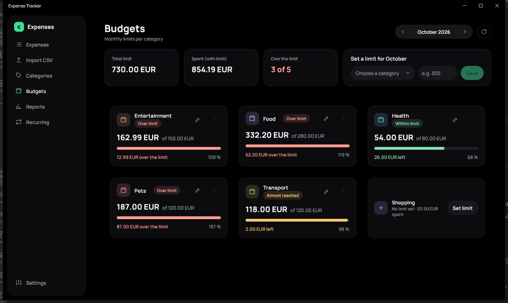
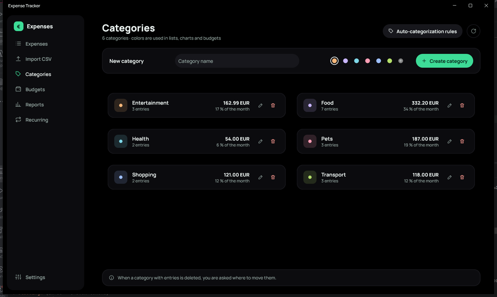
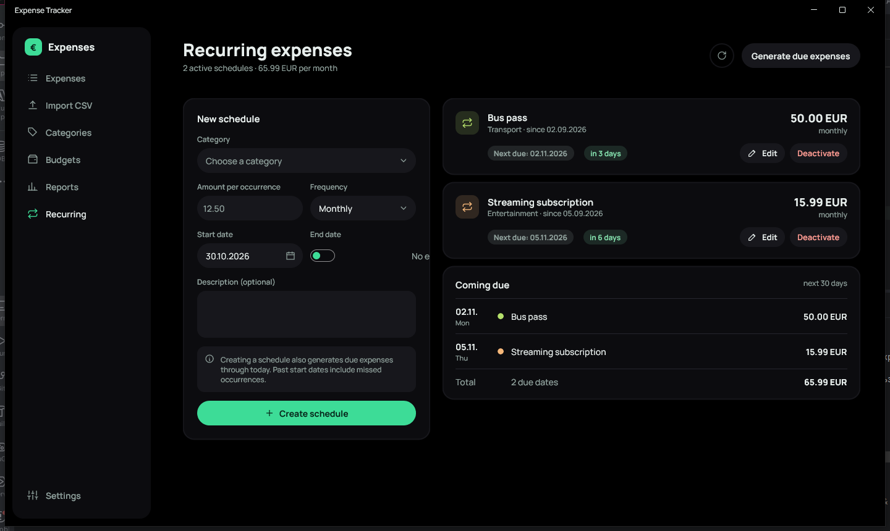
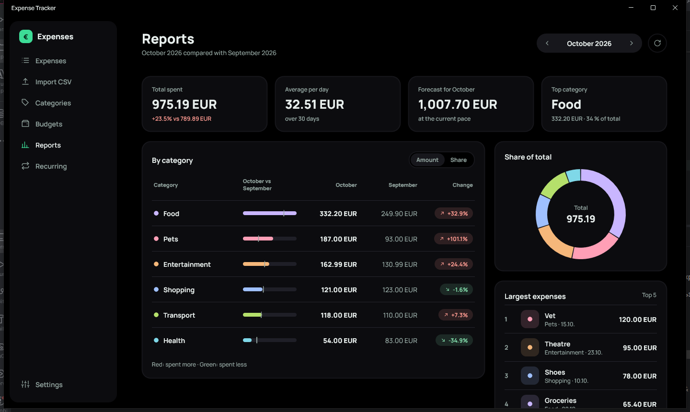
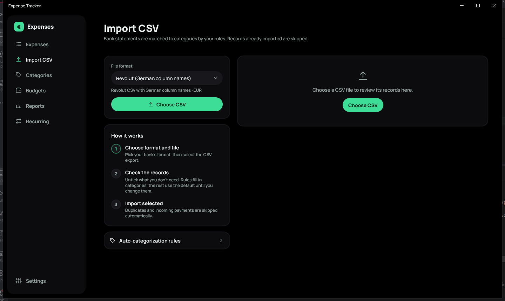
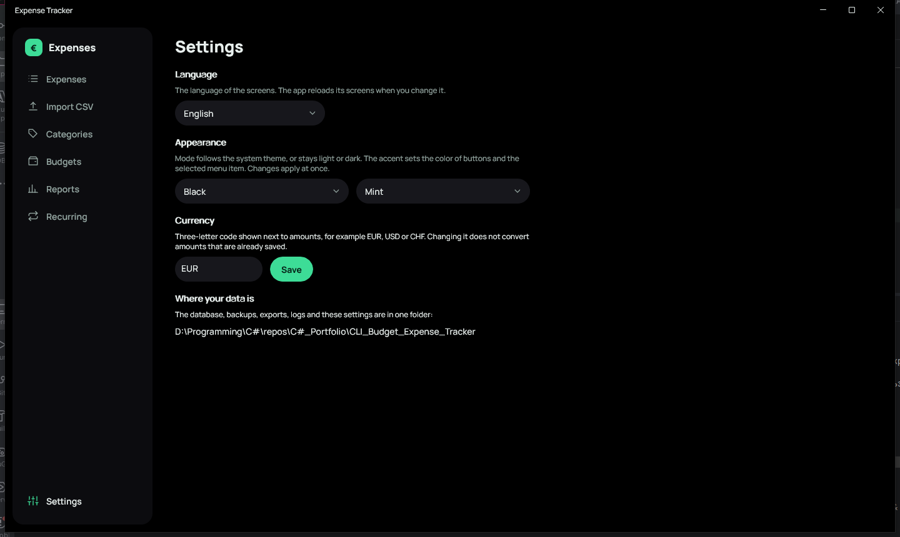

# Expense Tracker

[English](README.md) · **Deutsch**

Eine persönliche Haushalts- und Ausgabenverwaltung für Windows, entwickelt mit **C#, .NET 10 und .NET MAUI**.
Alle Daten liegen in einer lokalen SQLite-Datei neben dem Projekt: kein Konto, kein Server, keine Cloud.


## Das Wichtigste

- **Vollständiger Ausgaben-Workflow**: hinzufügen, bearbeiten, löschen; Suche und Filter nach Kategorie /
  Monat / Zeitraum / Betragsspanne; Sortierung; Export als CSV und Markdown.
- **Monatsbudgets** mit Status je Kategorie (im Rahmen, fast erreicht, überschritten) und einer Warnung,
  wenn eine neue Ausgabe ein Limit überschreitet.
- **Wiederkehrende Ausgaben** (täglich, wöchentlich, monatlich, jährlich), die beim Start automatisch erzeugt werden.
- **CSV-Import von Bankauszügen** mit Vorschau: Revolut und jede andere Bank (Spalten selbst zuordnen),
  automatische Kategorisierung per Regeln und Schutz vor Duplikaten durch Transaktions-Hashes.
- **Berichte**: Monat im Vergleich zum Vormonat, Anteil am Gesamten, größte Ausgaben, Durchschnitt pro Tag, Prognose.
- **Sicherer Umgang mit Daten**: Sicherungen vor Migrationen und destruktiven Aktionen, Wiederherstellung,
  weiches Löschen, Geldbeträge als ganze Cent gespeichert.
- **Vier Sprachen** (Englisch, Deutsch, Russisch, Ukrainisch) und **Designs**: System / Hell / Dunkel / Schwarz
  mit fünf Akzentfarben, zur Laufzeit umschaltbar.
- **Saubere Architektur**: eine framework-freie Domänenschicht, eine Infrastrukturschicht für EF Core und
  SQLite sowie eine MVVM-Anwendungsschicht.

## Bildschirme

| | |
|---|---|
|  |  |
|  |  |
|  |  |

*Die Oberfläche der Screenshots ist englisch; die App selbst lässt sich in den Einstellungen auf Deutsch umstellen.*

## Dokumentation

| Dokument | Inhalt |
|----------|--------|
| [Benutzerhandbuch](docs/de/BENUTZERHANDBUCH.md) | alle Bildschirme und Abläufe, Speicherorte, Sicherungen |
| [Architektur](docs/de/ARCHITEKTUR.md) | Schichten, Datenmodell, wichtige Entwurfsentscheidungen, UI-System |
| [Entwicklung](docs/de/ENTWICKLUNG.md) | Build, Start, Migrationen, Konventionen, Erweiterung, Stand |

Die englischen Fassungen liegen in [`docs/en`](docs/en).

## Voraussetzungen

- Windows 10 oder 11
- [.NET 10 SDK](https://dotnet.microsoft.com/download)
- Die .NET-MAUI-Workload: `dotnet workload install maui`
- Optional: JetBrains Rider oder Visual Studio 2022+ mit der .NET-MAUI-Workload

## Schnellstart

```powershell
dotnet run --project ExpenseTracker.App -f net10.0-windows10.0.19041.0
```

Oder `CLI_Budget_Expense_Tracker.sln` in Rider oder Visual Studio öffnen, `ExpenseTracker.App` wählen und starten.
Die Datenbank wird beim ersten Start automatisch angelegt und aktualisiert.

## Technik

| Bereich | Wahl |
|---------|------|
| Sprache / Laufzeit | C# 14, .NET 10 |
| Oberfläche | .NET MAUI (Windows), XAML, Shell-Navigation, MVVM mit CommunityToolkit.Mvvm |
| Daten | EF Core + SQLite, Code-First-Migrationen |
| Zeichnen | `GraphicsView` / `IDrawable` für Icons, Ringdiagramm und Balken (keine Diagrammbibliothek) |
| Schrift | Manrope (fünf Schnitte, eingebunden) |
| CI | GitHub Actions (Build auf `windows-latest`) |

## Projektstruktur

| Projekt | Zweck |
|---------|-------|
| `CLI_Budget_Expense_Tracker.Core` | Modelle, Dienste und Schnittstellen; kennt weder EF Core noch die Oberfläche |
| `CLI_Budget_Expense_Tracker.Infrastructure` | EF Core und SQLite, Migrationen, Repositories, CSV-Import und -Export, Sicherungen |
| `ExpenseTracker.App` | die .NET-MAUI-Anwendung: Views, ViewModels, Steuerelemente, Dienste |

## Stand

Die Anwendung funktioniert durchgängig. Noch offen: automatische Tests, ein Windows-Release-Build und
Demodaten für Screenshots. Der ausführliche Plan steht in
[`ExpenseTracker.App/ExpenseTracker-TZ-v3.md`](ExpenseTracker.App/ExpenseTracker-TZ-v3.md) (auf Russisch).
