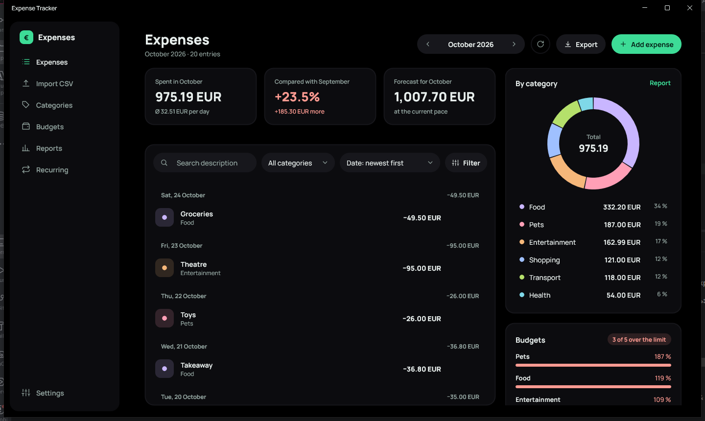
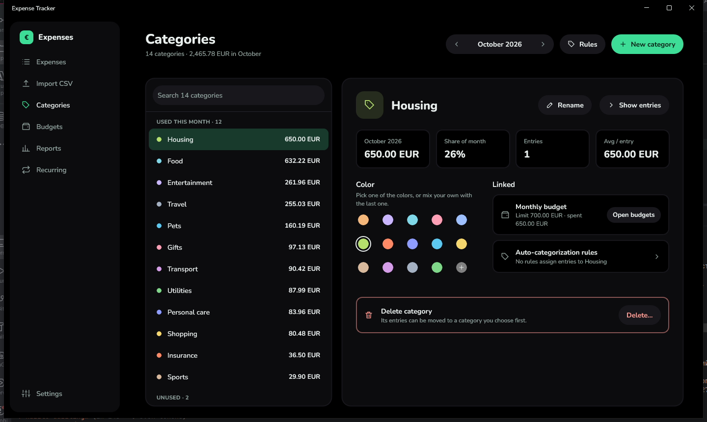
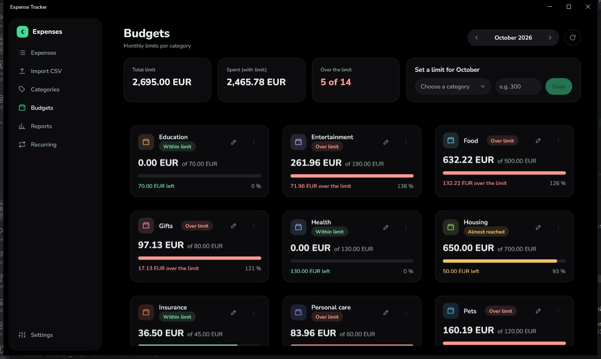
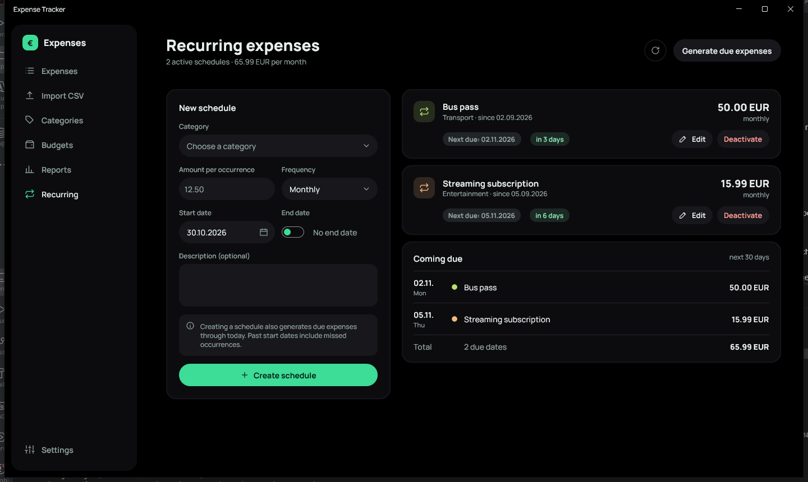
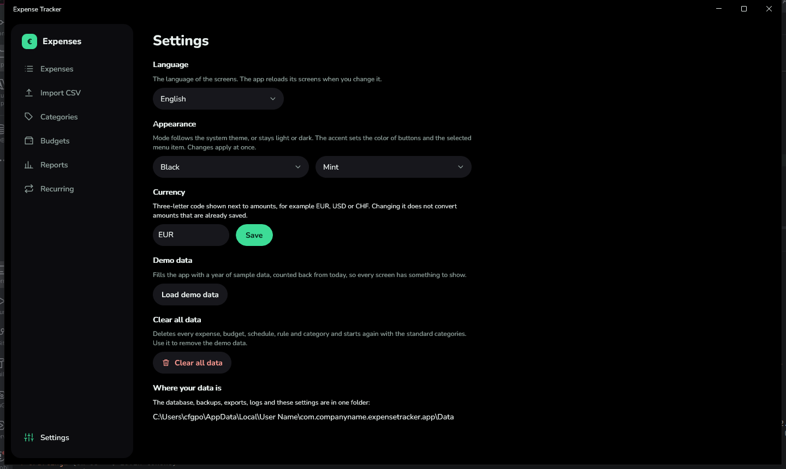

# User guide

[Back to README](../../README.md) · [Deutsch](../de/BENUTZERHANDBUCH.md)

Expense Tracker is a desktop app for recording what you spend, planning monthly limits and understanding where
the money goes. This guide describes every screen. Screenshots show the Black theme with the Mint accent.

## Contents

1. [Getting around](#1-getting-around)
2. [Expenses](#2-expenses)
3. [Import CSV](#3-import-csv)
4. [Categories](#4-categories)
5. [Budgets](#5-budgets)
6. [Reports](#6-reports)
7. [Recurring expenses](#7-recurring-expenses)
8. [Settings](#8-settings)
9. [Your data: location, backups, restore](#9-your-data)
10. [Troubleshooting](#10-troubleshooting)

## 1. Getting around

The menu on the left is always visible. It has one entry per screen: **Expenses**, **Import CSV**,
**Categories**, **Budgets**, **Reports**, **Recurring**, and **Settings** at the bottom. The open screen is
highlighted.

Common elements:

- **Month switch**: arrows step one month; a click on the month name opens a small calendar where you pick
  any month of any year. It appears on Expenses, Budgets and Reports.
- **Round refresh button** next to the month switch reloads the screen.
- **Drop-downs and date fields** open a list or calendar directly below the field.
- Scrolling works with the mouse wheel; scroll bars are hidden on purpose.

## 2. Expenses

The main screen. It shows one month at a time.

**Header.** Title with the number of entries, the month switch, refresh, **Export** and **Add expense**.

**Three figures.**

| Card | Meaning |
|------|---------|
| Spent in *month* | total of the shown expenses and the average per day |
| Compared with *previous month* | percentage and amount difference (red = more, green = less). If the previous month had no expenses, the percentage shows "–". |
| Forecast for *month* | average per day multiplied by the days of the month (current month only) |

**List.** Expenses are grouped by day (when sorted by date), with the day total at the right of each heading.
Move the pointer over a row to show the **edit** and **delete** icons. Deleting asks for confirmation.

**Search and filters.**

- The search field looks in the description. Press Enter to apply.
- *All categories* and the sort order (newest/oldest first, highest/lowest amount) apply at once.
- The **Filter** button opens a panel with the period (month, all time, custom range), the dates of a custom
  range and a minimum and maximum amount. A badge on the button shows how many of these filters are active.
  Use **Apply** and **Reset**.

**Chart and budgets (right column).**

- The **donut chart** splits the period by category. It always shows all categories, even when the list is
  filtered. Move the pointer over a segment to enlarge it. A click on a segment or on a legend row
  filters the list to that category; a second click removes the filter. **Report** opens the Reports screen.
- The **Budgets** card shows the three categories closest to or over their limit and how many are over.

**Export.** The menu offers *CSV*, *Markdown* and *Backup*. CSV and Markdown contain exactly the expenses
currently shown (period, category, search and amount range). Files are saved in the `exports` folder.

**Add or edit an expense.** Choose a category (or create a new one on the spot), enter the amount (a dot or
comma works; at most two decimals), the date (not in the future) and an optional description. If the expense
pushes the category over its monthly limit, a warning shows the amounts. An expense that was generated by a
recurring schedule keeps its date; other fields can be changed for this one occurrence.

## 3. Import CSV

Imports a bank statement. Nothing is saved before you confirm.

1. **Choose the format.** *Revolut (German column names)* works out of the box. For any other bank choose
   *Other bank CSV*.
2. **Choose the file** with **Choose CSV**. For another bank, describe how the file is written: delimiter,
   number format (for example `1,234.56` or `1.234,56`), date format (for example `dd.MM.yyyy`), the date,
   description and amount columns, an optional currency column, and whether money spent is a negative or a
   positive number. These choices are remembered for the next import. Press **Show preview**.
3. **Review the records.** The table shows date, description, amount and category.
   - Records that can be imported are ticked. Untick what you do not need; the box in the header selects all.
   - A **Rule** chip means that an auto-categorization rule picked the category. Records without a rule use the
     **Default category** (left column) and have a yellow outline; change them in the drop-down.
   - Incoming payments and internal transfers are gray and skipped.
   - The chips above the table count rules matched, records on the default category and records skipped.
4. **Import.** The bar at the bottom always shows *N of M selected* and the sum. **Import N records** saves them.
   Records imported before are detected by a hash of the transaction and skipped, so importing a file twice
   is safe. The result shows how many were added, skipped as duplicates or not imported.

**Auto-categorization rules** (link on this screen, or **Categories → Auto-categorization rules**): a rule says
"if the description contains *text*, use *category*". Case does not matter. When several rules fit, the longest
text wins.

## 4. Categories

Each category is a tile with its color, the number of entries this month, the amount and its share of the month.

- **New category**: type a name, pick a color and press **Create category**. The row offers six palette
  colors and a **+** swatch that opens a color picker for a color of your own. Names must be unique
  (case-insensitive).
- **Rename** with the pencil icon: the form switches to rename mode; you can change the color too.
- **Delete** with the trash icon. If the category is not used, it is deleted after a confirmation. If it is used,
  you can either **move its expenses and schedules to another category**, or **delete the category together
  with all its data**. The second option makes a backup first and asks for a second confirmation.

Category colors are the same on every screen (lists, donut chart, budgets, reports).

## 5. Budgets

A monthly spending limit per category.

- At the top: **total limit**, **spent (with limit)** and **how many categories are over**.
- **Set a limit for *month***: choose a category, enter the amount and press **Save**. A limit of 0 means that
  nothing is planned for this category. Saving again changes the limit.
- Each category with a limit is a card: the amount spent, the limit, a progress bar and the remaining amount or
  the overspend. The status is **Within limit**, **Almost reached** (from 90 %) or **Over limit**.
- The **pencil** puts the category into the form; the **three-dot** menu removes the limit (your expenses are kept).
- Categories without a limit are shown as dashed cards with a **Set limit** button.

Limits belong to a month, so every month has its own limits.

## 6. Reports

An analysis of one month against the month before.

- Four figures: **total spent** (with the change), **average per day**, **forecast** and the **top category**.
- **By category**: for each category a bar for this month and a thin mark for the previous month on the same
  scale, both amounts and a **change** chip (red arrow up = more, green arrow down = less). The switch
  **Amount / Share** changes the bars to shares of the total.
- **Share of total**: the donut chart. **Largest expenses**: the five biggest single expenses.
- A click on a category (in the table or on the donut) opens Expenses for that category and month.

## 7. Recurring expenses

For payments that repeat: rent, subscriptions, insurance.

- **New schedule**: category, amount per occurrence, frequency (daily, weekly, monthly, yearly), start date,
  optional end date (switch it on to enter one) and a description.
- Creating a schedule also **generates the expenses that are already due, up to today**; a start date in the
  past creates the missed occurrences. The app also generates due expenses every time it starts.
  **Generate due expenses** does it on demand.
- Each schedule is a card with the amount, the frequency, the next due date and a chip such as "in 3 days".
  **Edit** changes future expenses only; expenses created earlier stay as they are, and a new frequency counts
  from the next due date. **Deactivate** stops generating; **Reactivate** resumes; **Delete** removes the
  schedule (an inactive one) and keeps the expenses it already created.
- **Coming due** lists the due dates of the next 30 days with their sum.

## 8. Settings

- **Language**: English, German, Russian or Ukrainian. The screens reload when you change it. Month and day
  names follow the language.
- **Appearance**: the *mode* (System follows Windows, Light, Dark, Black with a pure black background) and the
  *accent* (Lavender, Mint, Sky, Rose, Amber). Changes apply immediately, including the title bar.
- **Currency**: a three-letter code (EUR, USD, CHF...) shown next to amounts. It does not convert saved amounts.
- **Demo data**: **Load demo data** adds a year of sample expenses, budgets, recurring schedules and rules,
  counted back from today, so every screen has something to show. Your own data stays; a backup is made first.
  Loading it twice adds more expenses.
- **Where your data is**: the folder with the database, backups, exports, logs and settings.

## 9. Your data

The app looks for the solution (`.sln`) file above the folder it runs from and keeps everything next to it.
If there is none, the data goes to the application data folder.

| Path | Content |
|------|---------|
| `expense-tracker.db` | the SQLite database |
| `backups/` | backups: `backup-…` made by you, `auto-…` made by the app |
| `exports/` | exported CSV and Markdown files |
| `logs/` | one log file per day, kept for 14 days |
| `settings.json` | currency, language, theme, accent, category colors, last CSV column choices |

**Backup.** *Export → Backup → Create backup* makes a consistent snapshot of the database (using the SQLite
backup API). The app also makes an automatic backup before a database upgrade and before a category is deleted
together with its data.

**Restore.** *Export → Backup → Restore from backup*, choose a file (newest first) and confirm. The current
database is saved first, so a restore can be undone with another restore.

Deleted expenses are marked as deleted instead of being removed from the file (soft delete); a backup is the
way to bring a deleted category and its data back.

## 10. Troubleshooting

| Problem | What to do |
|---------|------------|
| A message says that something went wrong | the error was written to the log; open the `logs` folder and read today's file |
| A list looks outdated | press the round refresh button |
| An import cannot be read | check the delimiter, number format, date format and columns; the message names the problem |
| A category cannot be created | the name already exists (case-insensitive) |
| An amount is rejected | use a positive number with at most two decimals; a dot or comma is fine |
| The window looks too narrow | the right column of Expenses steps aside below about 900 px of content width; make the window wider |
